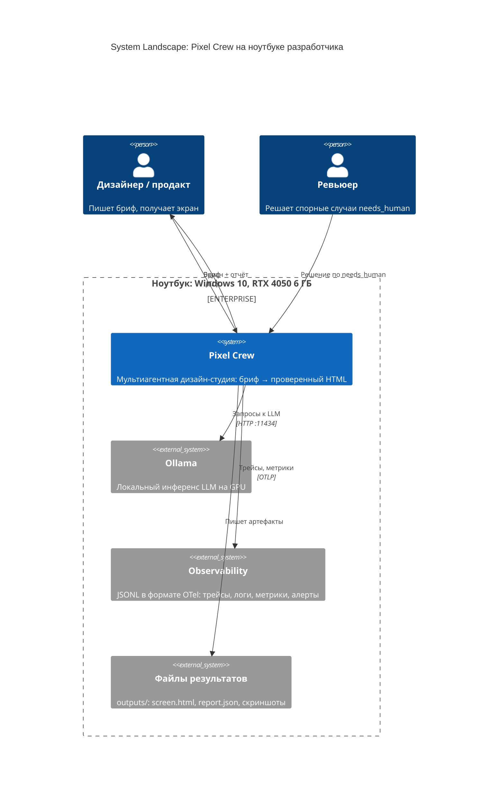
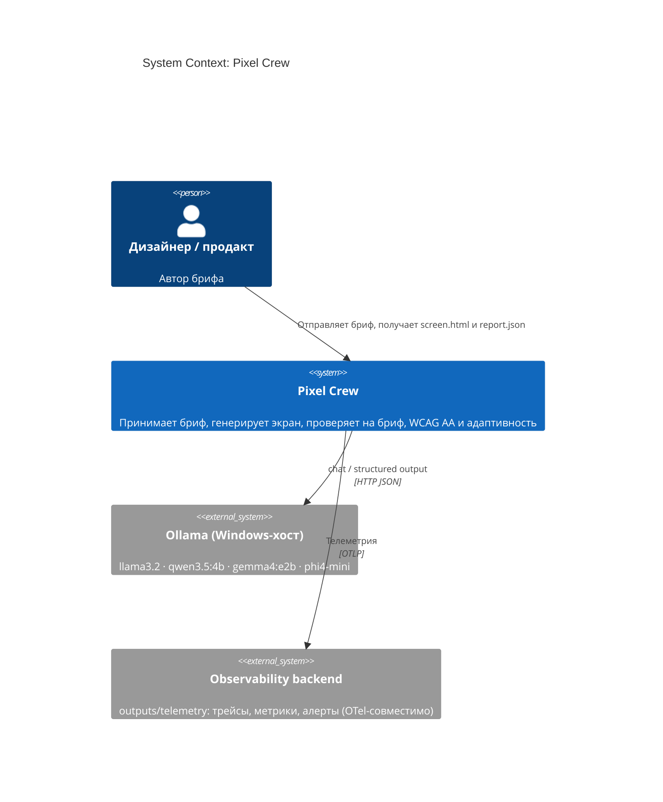
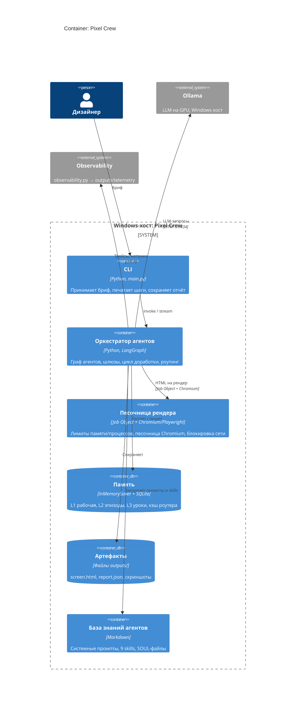
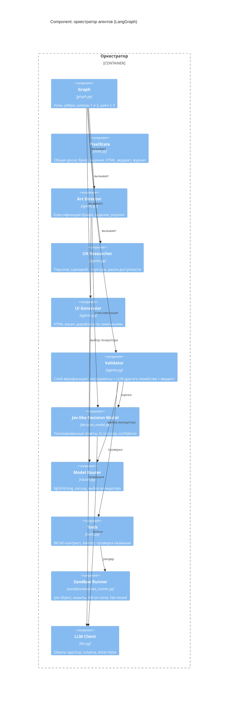
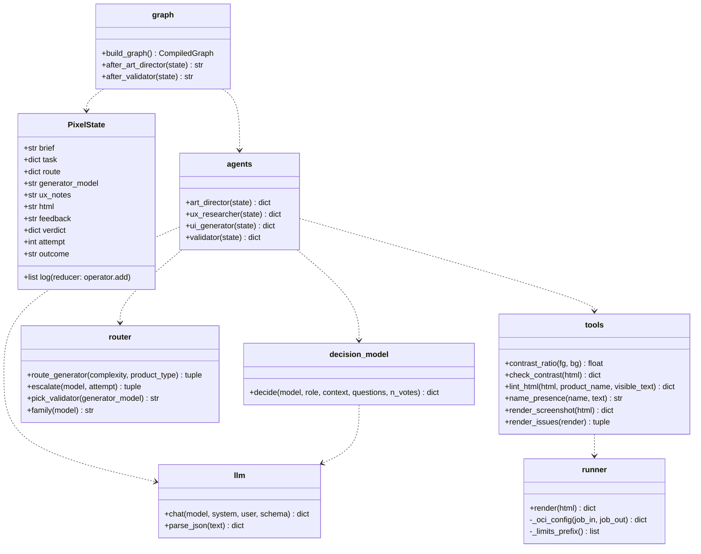
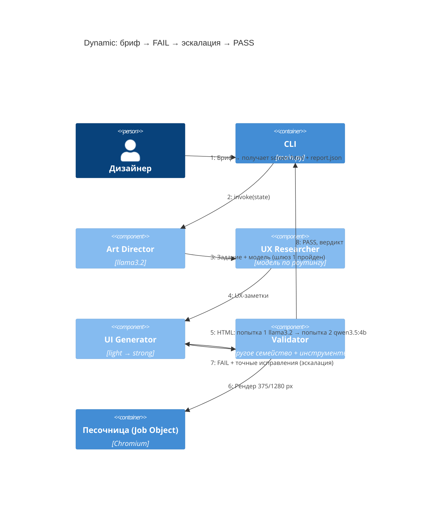
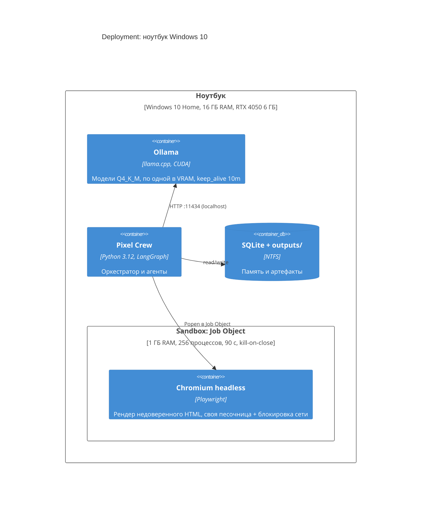
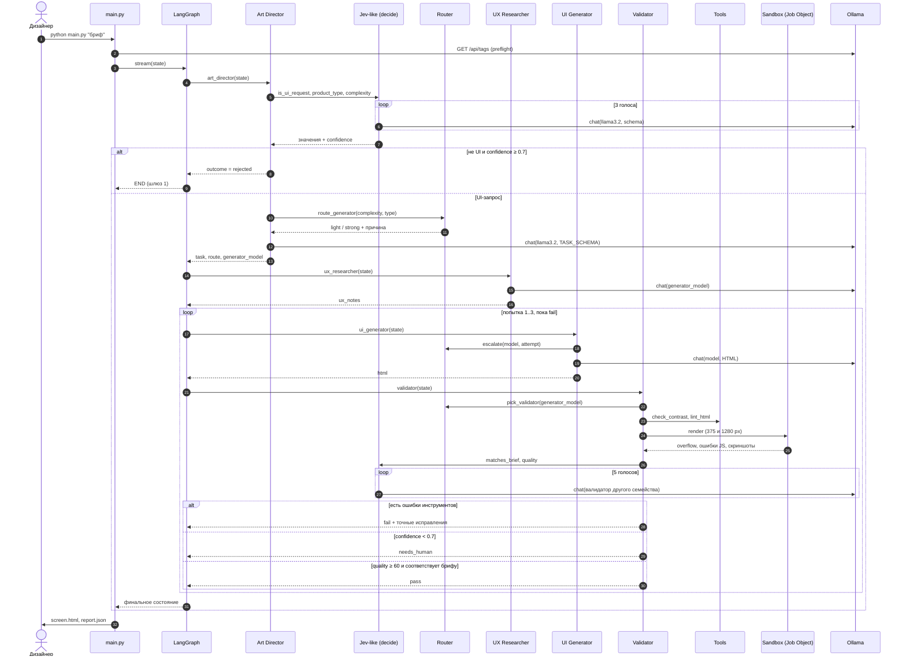

# 9. Архитектура системы

## 9.1. Выбранный паттерн и почему

Сначала я вообще не понимала, что от меня хотят под «мультиагентной системой» — грозное слово, а по факту нужен конвейер «бриф → экран → проверка». Перебрала паттерны один за другим и для каждого спрашивала себя: «а выдержит ли это модель 3B?» Таблица ниже — итог этих раздумий:

Pixel Crew — **оркестрируемый граф агентов** (orchestrator–workers на LangGraph). Внутри графа есть цикл **evaluator–optimizer** (генератор ⇄ независимый валидатор) и общее состояние в стиле **blackboard** (`PixelState`).

| Паттерн | Суть | Плюсы | Минусы | У нас |
|---|---|---|---|---|
| Один агент (ReAct) | Одна LLM в цикле «мысль → действие → наблюдение» | Просто | Проверяет сам себя, контекст переполняется, маленькая модель теряет нить | ✗ |
| Конвейер (prompt chaining) | Фиксированная цепочка шагов | Предсказуемо, дёшево | Нет обратной связи и исправления ошибок | Основа потока |
| **Оркестратор + исполнители** | Центральный узел ставит задачу и маршрутизирует | Контроль, роутинг по сложности | Оркестратор — единая точка отказа | ✓ Art Director |
| **Evaluator–optimizer** | Генератор ⇄ оценщик до прохождения порога | Качество растёт с попытками | Время ×N, нужен лимит попыток | ✓ цикл доработки, ≤ 3 попытки |
| Supervisor / иерархия (LLM решает, кого звать) | LLM-менеджер выбирает следующего агента | Гибкость | На 3–4B моделях ненадёжно, сложно отлаживать | ✗ переходы решает код |
| Хореография / swarm | Агенты передают управление друг другу сами | Нет центра, масштабируется | Трудно гарантировать завершение и порядок | ✗ |
| Debate / multi-agent chat | Агенты обсуждают решение | Разнообразие мнений | Многословно и дорого по токенам | ✗ (вместо этого — N голосов Jev-like) |
| **Blackboard** | Общее хранилище, из которого агенты читают и куда пишут | Слабая связность агентов | Нужна дисциплина схемы состояния | ✓ `PixelState` |

**Почему так — коротко:** я долго думала, отдать ли управление потоком LLM (как в CrewAI hierarchical или AutoGen group chat). Отказалась: на моделях 3–4B «менеджер» будет тупить и зацикливаться, а отлаживать это — кошмар. Поэтому LLM даёт **оценки** (Jev-like решения с уверенностью), а **переходы** выбирает код с порогами. Проверка отделена от генерации и выполняется **моделью другого семейства** вместе с детерминированными инструментами — это и есть слой верификации из ТЗ.

### Слои агента

| Слой | Что входит |
|---|---|
| 1. Интерфейс | CLI `main.py` → далее HTTP API/UI |
| 2. Оркестрация | LangGraph: граф, шлюзы, цикл, лимит попыток, human-in-the-loop |
| 3. Принятие решений | Jev-like модель (`decision_model.py`) + роутер моделей (`router.py`) |
| 4. Агенты | Art Director, UX Researcher, UI Generator (роли = промпты + skills + SOUL-файлы) |
| 5. **Верификация и валидация** | Validator: инструменты (контраст, линтер, рендер в песочнице) + LLM другого семейства + пороги + `needs_human` |
| 6. Инструменты | `tools.py`, `sandbox/` (Job Object) |
| 7. Память | short-term: состояние и чекпоинты; long-term: история запусков и уроки дизайна |
| 8. Модели | Ollama: llama3.2, qwen3.5:4b, gemma4:e2b, phi4-mini |
| 9. Наблюдаемость | логи, трейсы, метрики, алерты, траектории (раздел 16) |

## 9.2. Диаграммы C4

Семь диаграмм по c4model.com: 4 основных уровня (Context, Container, Component, Code) и 3 дополнительных (System Landscape, Dynamic, Deployment). Формат — Mermaid: исходник рендерится на GitHub, в VS Code и на mermaid.live.

### 9.2.1. System Landscape — Pixel Crew в окружении

### 9.2.2. System Context

### 9.2.3. Container

### 9.2.4. Component — оркестратор

### 9.2.5. Code — ключевые классы и функции

### 9.2.6. Dynamic — обработка брифа с доработкой

### 9.2.7. Deployment

## 9.3. Sequence Diagram — полный поток

## 9.4. Как архитектура закрывает требования ТЗ

| Требование | Где |
|---|---|
| Агенты объединены в одну систему, есть роутинг (не «несколько сингл-агентов») | Граф LangGraph, общее состояние, условные рёбра |
| Слой верификации и валидации | Validator: инструменты + LLM + пороги + `needs_human` |
| Валидатор роутит на LLM другого семейства | `router.pick_validator()`, тест `test_validator_is_always_other_family` |
| Роутинг на разные LLM | `router.route_generator()` + каскад `escalate()` |
| Jev-like модель | `decision_model.decide()` на входе и выходе |
| Изоляция | Windows Job Object + песочница Chromium (Deployment-диаграмма, раздел 4) |
